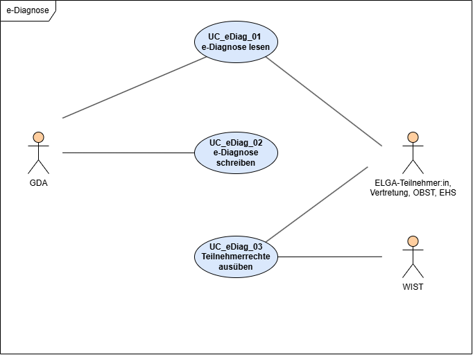

# Überblick Anwendungsfälle - ELGA e-Diagnose R4 v0.1.1

## Überblick Anwendungsfälle

### Fachliche Anwendungsfälle

Die fachlichen Anwendungsfälle sind [**hier**](https://developer.elga.gv.at/apis/ediag/use-cases/) nachzulesen.

#### Anwendungsfalldiagramm

Das folgende Anwendungsfalldiagramm zeigt die zentralen Anwendungsfälle der e-Diagnose und die Interaktion der verschiedenen Akteure.

### Technischen Anwendungsfälle

In den folgenden Kapiteln werden die fachlichen Anwendungsfälle der e-Diagnose als technische Anwendungsfälle beschrieben. Die zugehörigen Sequenzdiagramme veranschaulichen die Interaktionen und Abläufe zwischen den beteiligten Akteuren.

* [Lesenender Zugriff auf die e-Diagnose](use_case_read.md)
* [Schreibender Zugriff auf die e-Diagnose](use_case_write.md)
* [Ausübung von Teilnehmerrechten](use_case_participant.md)

