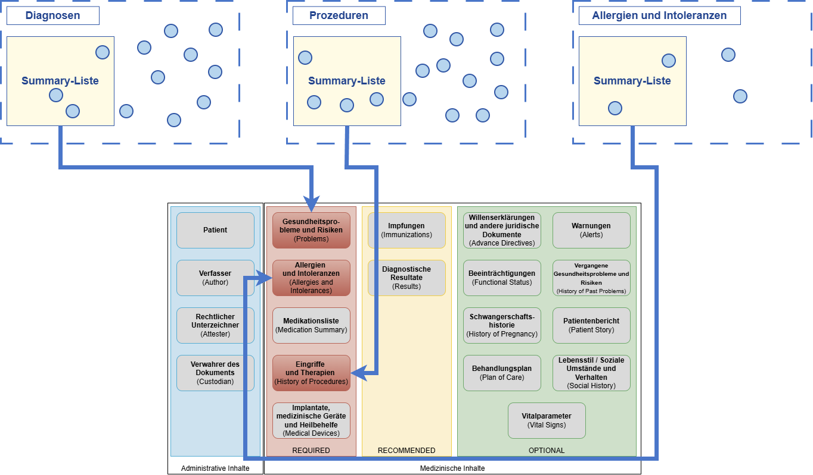

# Hintergrund - ELGA e-Diagnose R4 (Draft) v0.1.0

## Hintergrund

Die strukturierte Dokumentation und der Austausch von Diagnosen, Prozeduren sowie Allergien und Intoleranzen sind eine wesentliche Grundlage für die medizinische Versorgung. Die e-Diagnose soll diese Informationen übergreifend in ELGA verfügbar machen und damit eine gesamthafte Übersicht über den Gesundheitszustand sowie die weitere Behandlung unterstützen. Zudem soll sie die Grundlage für die [Austrian Patient Summary (APS)](https://fhir.hl7.at/elga/aps/r4) schaffen.

### Fachliches Umfeld & Datenkategorien

Die IPS unterscheidet mehrere Datenkategorien. Diese werden im Rahmen der Konzeption der e-Diagnose berücksichtigt, insbesondere im Hinblick auf die spätere Verwendung der Daten für die APS.

| | | |
| :--- | :--- | :--- |
| **Problems** | Condition | Summary-Liste für Diagnosen |
| **History of Procedures** | Procedure | Summary-Liste für Prozeduren |
| **Allergies and Intolerances** | AllergyIntolerance | Summary-Liste für Allergien und Intoleranzen |

