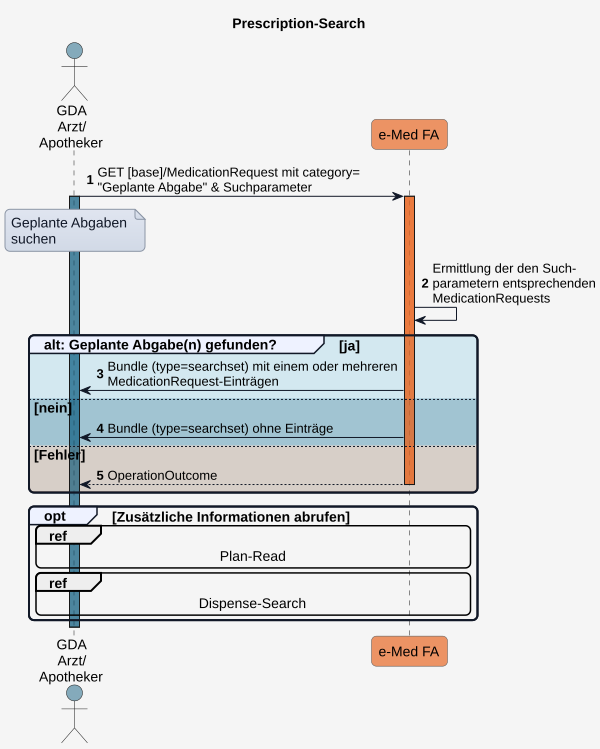
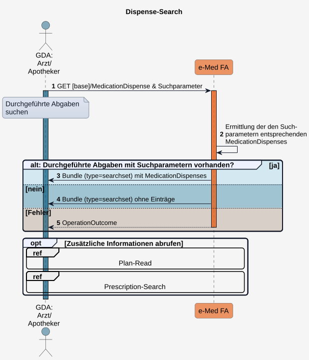
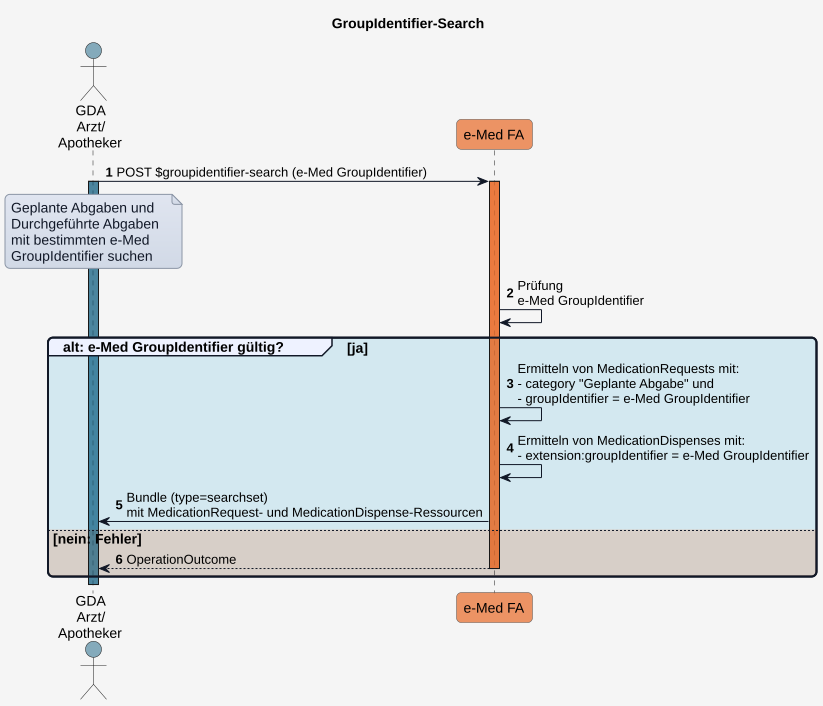

# ​Technische Use Cases für Geplante und Durchgeführte Abgaben lesen (UC_eMed_03) - ELGA e-Medikation (R4) DRAFT v0.1.0

## ​Technische Use Cases für Geplante und Durchgeführte Abgaben lesen (UC_eMed_03)

Dieser technische Use Case beschreibt den lesenden Zugriff berechtigter Akteure auf:

* [Geplante Abgaben](Sub_UC_eMed_03.md#sub_uc_emed_03_01---geplante-abgaben-lesen-prescription-search), um vorgesehene Arzneimittelabgaben einzusehen,
* [Durchgeführte Abgaben](Sub_UC_eMed_03.md#sub_uc_emed_03_02---durchgeführte-abgaben-lesen-dispense-search), um bereits erfolgte Arzneimittelabgaben einzusehen
* [Geplante und Durchgeführte Abgaben mit e-Med Groupidentifier](Sub_UC_eMed_03.md#sub_uc_emed_03_03---geplante-und-durchgeführte-abgaben-mittels-e-med-groupidentifier-lesen-groupidentifier-search), um die zu einem e-Rezept zugehörigen **Geplanten Abgaben** und **Durchgeführten Abgaben** abzurufen zu können.

Für ELGA-Teilnehmer und deren Vertretungen erfolgt der lesende Zugriff auf **Geplanten Abgaben** und **Durchgeführten Abgaben** über das ELGA-Zugangsportal.

Für die übrigen Akteure erfolgt der lesende Zugriff über die e-Medikations-Schnittstelle des jeweiligen GDA-Systems.

Dabei werden folgende **Zugriffsarten** unterschieden:

* **Zugriff mit Kontaktbestätigung**: Der Standardzugriff erfolgt nach Kontaktbestätigung des ELGA-Teilnehmers (z.B. mittels e-card). Dadurch erhält der GDA einen, seiner Rolle entsprechenden ELGA-Zugriff, inkl. lesenden Zugriff auf alle **Geplanten Abgaben** (siehe [Sub_UC_eMed_03_01 - Geplante Abgaben lesen (Prescription-Search)](Sub_UC_eMed_03.md#sub_uc_emed_03_01---geplante-abgaben-lesen-prescription-search)) und auf alle **Durchgeführten Abgaben** (siehe [Sub_UC_eMed_03_02 - Durchgeführte Abgaben lesen (Dispense-Search)](Sub_UC_eMed_03.md#sub_uc_emed_03_02---durchgeführte-abgaben-lesen-dispense-search)) und kann entsprechende Arzneimittelabgaben durchführen und dokumentieren ([Dispense-Write](Sub_UC_eMed_05.md#durchgeführte-abgabe-schreiben-dispense-write)). Weiters kann der Medikationsplan des ELGA-Teilnehmers abgerufen werden ([Plan-Read](Sub_UC_eMed_01.md#sub_uc_emed_01_01---aktuellen-medikationsplan-lesen-plan-read)), um die die gesamte Medikation beurteilen zu können. Durchgeführte Abgaben ohne Medikationsplanbezug, z.B. [OTC-Abgaben](Sub_UC_eMed_05.md#sub_uc_emed_05_01_05---durchgeführte-abgabe-ohne-bezug-zu-einer-geplanten-abgabe-erfassen) können ebenfalls dokumentiert werden.
* **Zugriff mittels **e-Med GroupIdentifier****: Alternativ steht **ohne Kontaktbestätigung** des ELGA-Teilnehmers der Zugriff mittels **e-Med GroupIdentifier** (z.B. über den DataMatrix-Code eines e-Rezepts) zur Verfügung. Dieser ermöglicht ausschließlich einen **eingeschränkten ELGA-Zugriff** auf die dem **e-Med GroupIdentifier** zugeordneten **Geplanten Abgaben** und **Durchgeführten Abgaben** und wird in [Sub_UC_eMed_03_03 - Geplante und Durchgeführte Abgaben mittels e-Med GroupIdentifier lesen (GroupIdentifier-Search)](Sub_UC_eMed_03.md#sub_uc_emed_03_03---geplante-und-durchgeführte-abgaben-mittels-e-med-groupidentifier-lesen-groupidentifier-search) beschrieben.

ℹ️ Die fachlichen Anforderungen dieses Use Cases werden im
[UC_eMed_03 Geplante und Durchgeführte Abgaben lesen](https://dev.elga.gv.at/apis/emed/use-cases/assets/pdfs/UC_eMed_03%20Geplante%20und%20durchgef%C3%BChrte%20Abgaben%20lesen.pdf)beschrieben.

Es gelten die dort festgelegten Vorbedingungen. Alle Zugriffe werden protokolliert.

### Sub_UC_eMed_03_01 - Geplante Abgaben lesen (Prescription-Search)

**Prescription-Search** dient der Suche nach [Geplante Abgaben](StructureDefinition-at-elga-emed-medicationrequest-geplanteabgabe.md) eines ELGA-Teilnehmers, um vorgesehene Arzneimittelabgaben einzusehen. Als **Geplante Abgabe** gilt eine **MedicationRequest**-Ressource mit **category "Geplante Abgabe"**.

**Geplante Abgaben** dokumentieren medizinische Inhalte des e-Rezepts. Wurden mehrere Arzneimittel gemeinsam verordnet und sind demselben e-Rezept zugeordnet, sind die zugehörigen **Geplanten Abgaben** mit demselben **e-Med GroupIdentifier** zu versehen, den auch das e-Rezept mitführt (bildet damit die Rezept-Klammer).

#### Suchparameter

Die Suche nach [Geplanten Abgaben](StructureDefinition-at-elga-emed-medicationrequest-geplanteabgabe.md) erfolgt mittels **GET**-Request unter Angabe geeigneter Suchparameter:

* alle (ohne Einschränkung)
* in einem bestimmten Zeitraum erfasste
* mit bestimmter Medikation: PZN/Name bzw. Wirkstoff (inkl. Magistraler Zubereitungen)
* mit einem bestimmten [status](ValueSet-GeplanteAbgabeStatusVS.md) 
* mit einem bestimmten **e-Med GroupIdentifier** 

 Ballot-Feedback: Gibt es zusätzliche Suchparameter die unterstützt werden sollen? [Suchparameter Überblick](interactions.md#suchparameter-überblick) 
 

Die gefundenen **Geplanten Abgaben** können als Ausgangspunkt für weitere Abfragen verwendet werden:

* zugehöriger Medikationsplaneintrag und Medikationsplanversion 
* da in einer **Geplanten Abgabe** die Referenz auf den zugehöigen Planeintrag (**basedOn**) nicht versioniert ist, zeigt die **Geplante Abgabe** immer auf den aktuellen Planeintrag. Dieser kann zwischenzeitlich von den Inhalten der **Geplanten Abgabe** abweichen.
 
* zugehörige **Durchgeführte Abgaben** (gleicher **e-Med GroupIdentifier** der **Geplanten Abgabe**)

Von ELGA-Teilnehmern gelöschte **Geplanten Abgaben** stehen nicht mehr zur Verfügung.

#### Ablauf

1. Der GDA führt einen**GET**-Request auf den Prescription-Search-Endpunkt mit**MedicationRequest.category "Geplante Abgabe"**und Suchparametern aus
1. Die Fachanwendung ermittelt die den Suchkriterien entsprechenden**Geplanten Abgaben**.
1. Die Fachanwendung liefert das Suchergebnis als Bundle vom Typ**searchset**zurück.
1. Werden keine passenden Ressourcen gefunden, enthält das zurückgelieferte Searchset Bundle keine Einträge.
1. Im Fehlerfall wird ein entsprechender**OperationOutcome**zurückgegeben.
1. Optional kann der GDA den**Medikationsplan**(siehe[Sub_UC_eMed_01_01 - Aktuellen Medikationsplan lesen (Plan-Read)](Sub_UC_eMed_01.md#sub_uc_emed_01_01---aktuellen-medikationsplan-lesen-plan-read)) und**Durchgeführte Abgaben**(siehe[Sub_UC_eMed_03_02 - Durchgeführte Abgaben lesen (Dispense-Search)](Sub_UC_eMed_03.md#sub_uc_emed_03_02---durchgeführte-abgaben-lesen-dispense-search)) zur fachlichen Beurteilung abrufen.

### Sub_UC_eMed_03_02 - Durchgeführte Abgaben lesen (Dispense-Search)

**Dispense-Search** dient der Suche nach [Durchgeführten Abgaben](StructureDefinition-at-elga-emed-medicationdispense-durchgefuehrteabgabe.md) eines ELGA-Teilnehmers, um bereits dokumentierte Arzneimittelabgaben einzusehen.

**Durchgeführte Abgaben** spiegeln den Status der Abgaben des e-Rezepts wider. Eine **Durchgeführte Abgabe**, die auf einer **Geplanten Abgabe** basiert, enthält den **e-Med GroupIdentifier** der zugehörigen **Geplanten Abgabe**. Dadurch können zusammengehörige **Geplante Abgaben** und **Durchgeführte Abgaben** über denselben **e-Med GroupIdentifier** identifiziert und gemeinsam abgerufen werden.

#### Suchparameter

Die Suche nach [Durchgeführten Abgaben](StructureDefinition-at-elga-emed-medicationdispense-durchgefuehrteabgabe.md) erfolgt mittels **GET**-Request unter Angabe geeigneter Suchparameter:

* alle (ohne Einschränkung)
* in einem bestimmten Zeitraum erfasste
* mit bestimmter Medikation: PZN/Name bzw. Wirkstoff (inkl. Magistraler Zubereitungen)
* mit einem bestimmten [status](ValueSet-AtElgaEmedValueSetMedicationDispenseStatusVS.md) 
* mit einem bestimmten **e-Med GroupIdentifier** 

Die gefundenen **Durchgeführten Abgaben** können als Ausgangspunkt für weitere Abfragen verwendet werden:

* zugehörige **Geplante Abgabe** (gleicher **e-Med GroupIdentifier**)
* zugehöriger Medikationsplaneintrag und Medikationsplanversion 
* da in einer **Durchgeführten Abgabe** die Referenzen auf den zugehöigen Planeintrag (**authorizingPrescription:planeintrag**) und die zugehörige **Geplante Abgabe** (**authorizingPrescription:geplanteAbgabe**) nicht versioniert sind, zeigt die **Durchgeführte Abgabe** immer auf die aktuellen Ressourcenversionen. Der Planeintrag kann zwischenzeitlich von den Inhalten der **Durchgeführte Abgabe** abweichen, die **Geplante Abgabe** kann zischenzeitlich einen anderen Status besitzen.
 

Von ELGA-Teilnehmern gelöschte **Durchgeführte Abgaben** stehen nicht mehr zur Verfügung.

 Ballot-Feedback: Gibt es zusätzliche Suchparameter die unterstützt werden sollen? [Suchparameter Überblick](interactions.md#suchparameter-überblick) 
 

#### Ablauf

1. Der GDA führt einen**GET**-Request auf den MedicationDispense-Search-Endpunkt mit Suchparametern aus.
1. Die Fachanwendung ermittelt alle den Suchkriterien entsprechenden**Durchgeführten Abgaben**.
1. Die Fachanwendung liefert das Suchergebnis als Bundle vom Typ**searchset**zurück.
1. Werden keine passenden Ressourcen gefunden, enthält das zurückgelieferte Searchset Bundle keine Einträge.
1. Im Fehlerfall wird ein entsprechender**OperationOutcome**zurückgegeben.
1. Optional kann der GDA den**Medikationsplan**(siehe[Sub_UC_eMed_01_01 - Aktuellen Medikationsplan lesen (Plan-Read)](Sub_UC_eMed_01.md#sub_uc_emed_01_01---aktuellen-medikationsplan-lesen-plan-read)) oder**Geplante Abgaben**(siehe[Sub_UC_eMed_03_01 - Geplante Abgaben lesen (Prescription-Search)](Sub_UC_eMed_03.md#sub_uc_emed_03_01---geplante-abgaben-lesen-prescription-search)) zur fachlichen Beurteilung abrufen.

### Sub_UC_eMed_03_03 - Geplante und Durchgeführte Abgaben mittels e-Med GroupIdentifier lesen (GroupIdentifier-Search)

Erfolgt die Arzneimittelabgabe **ohne Kontaktbestätigung** des ELGA-Teilnehmers, sondern auf Basis eines **e-Med GroupIdentifiers** (z.B. über den DataMatrix-Code eines e-Rezepts), erhält ein berechtigter GDA einen eingeschränkten ELGA-Zugriff.

Dieser umfasst ausschließlich den lesenden Zugriff auf die **dem **e-Med GroupIdentifier**** **zugeordneten** **Geplanten Abgaben** und **Durchgeführten Abgaben**. Der GDA kann anschließend **Durchgeführte Abgaben** ausschließlich für diesen **e-Med GroupIdentifier** dokumentieren (siehe [Variante B: Durchgeführte Abgabe mit e-Med GroupIdentifier schreiben](Sub_UC_eMed_05.md#variante-b-durchgeführte-abgabe-mit-e-med-groupidentifier-schreiben)).

Ein lesender Zugriff auf weitere **Geplante Abgaben** oder **Durchgeführte Abgaben** sowie auf den Medikationsplan des ELGA-Teilnehmers ist nicht möglich. Ebenso können keine weiteren **Durchgeführten Abgaben** (z.B. OTC- oder Notabgaben) in der e-Medikation des ELGA-Teilnehmers dokumentiert werden.

#### Ablauf

1. Der GDA führt die Custom Operation**POST**[$groupidentifier-search](OperationDefinition-at-elga-emed-operation-groupidentifier-search.md)aus und übermittelt einen**e-Med GroupIdentifier**.
1. Die Fachanwendung prüft den**e-Med GroupIdentifier**.
1. Ist der**e-Med GroupIdentifier**gültig, ermittelt die Fachanwendung alle**MedicationRequest**-Ressourcen der Kategorie**Geplante Abgabe**mit dem übermittelten**e-Med GroupIdentifier**.
1. Die Fachanwendung ermittelt alle**MedicationDispense**-Ressourcen mit dem übermittelten**e-Med GroupIdentifier**.
1. Die Fachanwendung liefert die ermittelten**MedicationRequest**- und**MedicationDispense**-Ressourcen als Bundle vom Typ**searchset**zurück.
1. Im Fehlerfall wird ein entsprechender**OperationOutcome**zurückgegeben.

#### Custom Operations

* **POST** [$groupidentifier-search](OperationDefinition-at-elga-emed-operation-groupidentifier-search.md)

