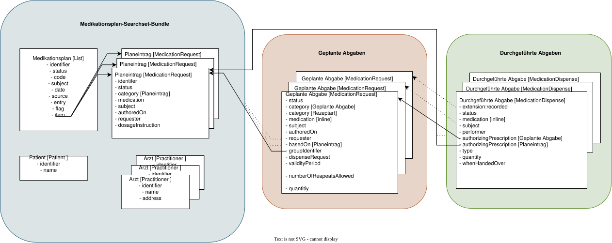

# Designentscheidungen - ELGA e-Medikation (R4) DRAFT v0.1.0

## Designentscheidungen

### Übersicht der Relevanten Ressourcen

Die folgende Abbildung zeigt den Aufbau des Medikationsplans sowie das Zusammenwirken der dabei verwendeten FHIR-Ressourcen.

Zentrale Ressource ist der Medikationsplan (**List**), der die einzelnen Medikationsplaneinträge (**MedicationRequest**) referenziert. Basierend auf diesen Planeinträgen werden **Geplante Abgaben** (**MedicationRequest**) erstellt, auf deren Grundlage **Durchgeführte Abgaben** (**MedicationDispense**) dokumentiert werden können.

Die Fachanwendung persistiert ausschließlich die einzelnen FHIR-Ressourcen. Historische Zustände werden durch versionierte Ressourcen und versionierte Referenzen abgebildet . Medikationsplan-Bundles dienen ausschließlich der Auslieferung eines Medikationsplans und werden bei Bedarf aus den entsprechenden Ressourcenversionen erzeugt.

 

#### Medikationsplan: AtElgaEmedListMedikationsplan (List)

Der Medikationsplan eines ELGA-Teilnehmers wird durch eine [List](StructureDefinition-at-elga-emed-list-medikationsplan.md)-Ressource abgebildet, welche keinen oder mehrere Planeinträge referenziert. Jeder Planeintrag ist im **List.entry.flag** durch einen Status gekennzeichnet (siehe [Status der List.entry.flag (Medikationsplan)](workflowmanagement.md#status-der-list-entry-flag-medikationsplan)).

Die List-Ressource bildet gemeinsam mit den referenzierten Ressourcenversionen die Grundlage für den Aufbau des aktuellen bzw. eines historischen Medikationsplans.

#### Medikationsplaneintrag bzw. Planeintrag: AtElgaEmedMedicationRequestPlaneintrag (MedicationRequest)

Ein Planeintrag im Medikationsplan wird durch eine [MedicationRequest](StructureDefinition-at-elga-emed-list-medikationsplan.md)-Ressource der Kategorie "Planeintrag" abgebildet. Die Ressource enthält genau ein verordnetes Arzneimittel mit der zugehörigen Dosierung.

Der Planeintrag kann in weiterer Folge als Grundlage für die Erstellung einer **Geplanten Abgabe** dienen.

In Abhängigkeit des zugehörigen List.entry.flags im Medikationsplan kann der Planeintrag unterschiedliche Status einnehmen (siehe [Status des MedicationRequests im Planeintrag](workflowmanagement.md#status-des-medicationrequests-im-medikationsplaneintrag)).

Abhängig vom List.entry.flag kann der Planeintrag nur bestimmte Statuswerte annehmen (siehe [Konsistenzregeln zwischen List.entry.flags und MedicationRequest-Status](workflowmanagement.md#konsistenzregeln-zwischen-listentryflags-und-medicationrequest-status)).

#### Geplante Abgabe: AtElgaEmedMedicationRequestGeplanteAbgabe (MedicationRequest)

Eine **Geplante Abgabe** eines Arzneimittels wird durch eine **MedicationRequest**-Ressource der Kategorie **Geplante Abgabe** abgebildet und dient der Nachvollziehbarkeit der rezeptierten Arzneimittel in der e-Medikation, siehe [Profil **Geplante Abgabe**](StructureDefinition-at-elga-emed-medicationrequest-geplanteabgabe.md).

#### Durchgeführte Abgabe: AtElgaEmedMedicationDispenseDurchgefuehrteAbgabe (MedicationDispense)

Die Ausgabe eines Arzneimittels wird mit einer **Durchgeführte Abgaben** in einer **MedicationDispense**-Ressource dokumentiert und dient der Nachvollziehbarkeit der abgegebenen Arzneimittel in der e-Medikation, siehe [Profil Durchgeführte Abgabe](StructureDefinition-at-elga-emed-medicationdispense-durchgefuehrteabgabe.md).

### Fachliche Designentscheidungen

#### Abhängigkeit von Planeintrag und Geplanter Abgabe

Gemäß Fachkonzept müssen Arzneimittel und Dosierung einer **Geplanten Abgabe** zum Zeitpunkt ihrer Erstellung mit dem zugehörigen Planeintrag identisch sein (siehe [Sub_UC_eMed_04_01](Sub_UC_eMed_04.md#sub_uc_emed_04_01---geplante-abgabe-erstellen-prescription-write)). Dies umfasst insbesondere das verordnete Arzneimittel einschließlich seiner PZN beziehungsweise die dokumentierten Wirkstoffe sowie die Dosierungsangaben. Enthält der Planeintrag nur Wirkstoffe, muss der Planeintrag zuvor angepasst und ein Präparat ausgewählt werden, bevor eine **Geplante Abgabe** erstellt werden kann.

Ziel dieser Vorgabe ist es, die Erstellung einer **Geplanten Abgabe** verbindlich mit der Aktualisierung des Medikationsplans zu verknüpfen. Der verordnende GDA soll die vorgesehene Medikation nicht ausschließlich in der **Geplanten Abgabe** dokumentieren, sondern erforderliche Änderungen auch im zugehörigen Planeintrag vornehmen. Der Medikationsplan soll dadurch die zum Zeitpunkt der Verordnung vorgesehene Medikation widerspiegeln. Eine neue **Geplante Abgabe** kann somit nicht auf Grundlage eines inhaltlich abweichenden Planeintrags erstellt werden.

Die Übereinstimmung wird ausschließlich zum Zeitpunkt der Erstellung der **Geplanten Abgabe** gefordert. Eine spätere Änderung des Planeintrags macht eine bereits erstellte **Geplante Abgabe** nicht automatisch ungültig. Da `basedOn` unversioniert ist, verweist diese Referenz auf den jeweils aktuellen Zustand des Planeintrags und hält nicht fest, welche Planeintragsversion bei der Erstellung der **Geplanten Abgabe** zugrunde lag.

**Vergleichsumfang**

| | |
| :--- | :--- |
| Arzneimittel (`medication`) | identisch |
| Dosierung (`dosageInstruction`) | identisch |
| Einnahmezeitraum (`effectiveDosePeriod`) | nicht identisch; Im Planeintrag kann der Beginn in der Vergangenheit liegen (z.B. bei Nacherfassung oder Dauermedikation seit Monaten). |
| Status, Kategorie, Ersteller,`dispenseRequest.*` | nicht vergleichbar |

**Abgrenzung der drei Ebenen**

| | |
| :--- | :--- |
| Planeintrag ↔**Geplante Abgabe** | Arzneimittel und Dosierung identisch (bei Erstellung) |
| **Geplante Abgabe**↔**Durchgeführte Abgabe** | Abweichungen möglich, dokumentiert in der**Durchgeführten Abgabe**(z.B. Präparat statt Wirkstoff) |

**Designentscheidung: Darf die **Geplante Abgabe** vom Planeintrag abweichen?**

| | |
| :--- | :--- |
| A: strikte Übereinstimmung (aktuell) | Abweichung ist nicht zulässig. Für ein Präparat wird zuerst der Planeintrag angepasst. |
| B: Konkretisierung zulässig | Die**Geplante Abgabe**darf einen Wirkstoff aus dem Planeintrag zu einem Präparat konkretisieren. Wirkstoff, Stärke, Darreichungsform und Dosierung bleiben trotzdem gleich, der Planeintrag bleibt unverändert. |

**Vorteile von A:**

* Die Erstellung einer **Geplanten Abgabe** setzt voraus, dass die zu verordnende Medikation auch im Planeintrag dokumentiert ist.
* Medikationsplan und **Geplante Abgabe** sind widerspruchsfrei. Änderungen des Präparats oder der Dosierung können nicht ausschließlich in der **Geplanten Abgabe** vorgenommen werden.
* Die Pflege des Medikationsplans wird dadurch verbindlich in den Verordnungsablauf eingebunden.
* Planeintrag und **Geplante Abgabe** verwenden zum Zeitpunkt der Erstellung dieselbe Arzneimittel- und Dosierungsdarstellung.

**Nachteile von A:**

* Der Planeintrag muss, falls dort nur ein Wirkstoff dokumentiert ist, vorab angepasst werden.
* Eine Wirkstoff-Angabe im Medikationsplan wird durch das Erstellen einer **Geplante Abgabe** früher oder später immer durch ein Präparat ersetzt.

**Vorteile von B:**

* Eine wirkstoffbasierte Darstellung kann im Medikationsplan erhalten bleiben, während die G**eplante Abgabe** das konkret verordnete Präparat dokumentiert.
* Eine reine Konkretisierung zum Präparat erfordert keine Änderung des Planeintrags.
* Der Medikationsplan kann unabhängig von einzelnen Präparateentscheidungen auf Wirkstoffebene geführt werden. **Nachteile von B:**
* Die Prüfregel wird komplexer (Wirkstoffabgleich). Die Übereinstimmung lässt sich nicht allein anhand identischer Arzneimittelangaben prüfen. Es sind zusätzliche Regeln für die fachliche Zuordnung zwischen Wirkstoffangabe und Präparat erforderlich.
* Medikationsplan und **Geplante Abgabe** enthalten unterschiedliche Darstellungsebenen derselben vorgesehenen Verordnung. Diese müssen für Anwender klar visualisiert werden.

 - Wie bleibt der Medikationsplan verständlich, wenn das abgegebene Arzneimittel vom Wirkstoff oder Präparat im Planeintrag und von der *Geplanten Abgabe* abweicht?
 - Soll `basedOn` versioniert werden, um die geprüfte Planeintrag-Version nachvollziehen zu können? 

#### Automatische Statusänderungen der beim Plan-Read ausgelieferten Ressourcen

**Plan-Read** liefert den Medikationsplan in einem für die Bearbeitung aufbereiteten Zustand. Die Fachanwendung erzeugt dazu aus der aktuellen **List**-Version ein **temporäres** Bundle. Die persistierten Ressourcen bleiben unverändert:

* **List.entry.flag** **new** und **changed** werden als **unchanged** ausgeliefert.
* Einträge mit **removed** werden nicht ausgeliefert. Bleibt kein Eintrag übrig, wird **List.emptyReason = nilknown** gesetzt.
* Abgelaufene Planeinträge werden mit **removed** und **stopped** ausgeliefert.

**Plan-History-Search** liefert dagegen alle Inhalte, Status und Flags unverändert.

 * - Soll der GDA den aufbereiteten Zustand erhalten (Variante A, aktuell), welcher den Schreibvorgang vereinfacht, bei dem er aber den Originalstatus der persistierten Ressourcen nicht sieht, oder den persistierten Originalzustand (Variante B)? 

#### Gruppierung von Medikamenten

TODO

### Technische Designentscheidungen

#### Kennzeichnung der relevanten Elemente

Die in der e-Medikation relevanten Elemente werden nach einem Whitelisting-Ansatz festgelegt. Hierzu werden Elemente, die fachlich verarbeitet, gespeichert und in weiterer Folge für die Anzeige bereitgestellt werden sollen, in den Profilen explizit mit dem **Must Support Flag MS** gekennzeichnet.

Bei der Profilierung gelten folgende Regeln:

* Elemente, die von der zentralen Fachanwendung fachlich verarbeitet werden sollen, MÜSSEN mit Must Support gekennzeichnet werden.
* Elemente, deren Verwendung aufgrund einer fachlichen Entscheidung ausgeschlossen wird, MÜSSEN auf die Kardinalität 0..0 eingeschränkt werden. Der Ausschluss MUSS fachlich begründet und dokumentiert werden.
* Liegt keine fachliche Entscheidung zur Verwendung eines Elements vor, bleibt dessen Definition unverändert. Insbesondere wird ein Element nicht allein deshalb auf 0..0 eingeschränkt, weil es derzeit nicht verwendet wird. Ohne Must-Support-Kennzeichnung wird es jedoch nicht in die fachliche Verarbeitung aufgenommen.
* Für Modifier-Elemente MUSS eine explizite Entscheidung über deren Zulässigkeit und Verarbeitung getroffen und dokumentiert werden. Sie DÜRFEN NICHT ohne fachliche Bewertung der allgemeinen Regel für nicht unterstützte Elemente unterliegen.

Damit wird zwischen dem expliziten Ausschluss eines Elements und seiner fehlenden Unterstützung unterschieden: Ein auf 0..0 eingeschränktes Element DARF NICHT übermittelt werden. Ein anderweitig zulässiges Element ohne Must-Support-Kennzeichnung kann übermittelt werden, wird jedoch gemäß den nachfolgend beschriebenen Regeln ignoriert.

##### Kardinalitäten

Die in den anzuwendenden Profilen festgelegten Kardinalitäten MÜSSEN eingehalten werden. Fehlt ein verpflichtendes Element oder wird die zulässige maximale Anzahl von Wiederholungen überschritten, MUSS die Operation abgelehnt werden. Dies gilt insbesondere für die Übermittlung von Elementen, deren Kardinalität auf 0..0 eingeschränkt wurde. Die Ablehnung MUSS durch ein entsprechendes OperationOutcome begründet werden.

##### Must Support Profilierung

Die Must-Support-Kennzeichnung legt in diesem Implementierungsleitfaden fest, welche Elemente die zentrale Fachanwendung fachlich unterstützt. Übermittelte Werte dieser Elemente MÜSSEN entsprechend den jeweiligen fachlichen Regeln verarbeitet, gespeichert und für eine nachgelagerte Anzeige bereitgestellt werden.

Die Kennzeichnung begründet für sich allein keine Pflicht, ein Element in jeder Instanz zu übermitteln. Ob ein Element vorhanden sein muss, ergibt sich aus seiner Mindestkardinalität sowie aus gegebenenfalls zusätzlich festgelegten Bedingungen und Invarianten.

Bei der Kennzeichnung komplexer Elemente wird eindeutig festgelegt, welche ihrer Unterelemente unterstützt werden. Aus der Must-Support-Kennzeichnung eines übergeordneten Elements wird keine pauschale Unterstützung sämtlicher Unterelemente abgeleitet.

 Ergänzend könnten Obligations eingesetzt werden, um die mit der Kennzeichnung verbundenen Pflichten für die beteiligten Akteure präziser festzulegen. International werden Obligations von vielen Ländern für unterschiedliche Use Cases eingesetzt.
 Sollen Obligations eingesetzt werden, um die MS Markierungen noch aussagekräftiger zu machen? Feedback aus der Community ist erwünscht. 

##### Serverhalten bei Elementen ohne MS Markierung

Werden Elemente ohne Must-Support-Kennzeichnung übermittelt, MUSS die zentrale Fachanwendung diese Elemente ignorieren. Sie werden nicht fachlich verarbeitet, gespeichert oder für die Anzeige im Portal bereitgestellt.

Die Response MUSS ein OperationOutcome enthalten, das mit `OperationOutcome.issue.severity = information` auf die ignorierten Elemente hinweist. Die Meldung MUSS die betroffenen Elemente eindeutig benennen und deutlich machen, dass deren Inhalte weder verarbeitet noch gespeichert wurden. Die Übermittlung solcher Elemente allein führt nicht zur Ablehnung der Operation.

Diese Regel DARF NICHT verwendet werden, um Profilverletzungen zu tolerieren. Insbesondere MÜSSEN übermittelte Elemente mit der Kardinalität 0..0 zur Ablehnung führen. Für Modifier-Elemente gelten die jeweils explizit festgelegten Entscheidungen.

#### Profile für die Abbildung von Operation In & Output

Die Ressourcen und Bundles unterscheiden sich abhängig davon, ob sie als Eingabe einer schreibenden Operation, als Ergebnis eines Schreibvorgangs oder als Ausgabe einer lesenden Operation verwendet werden. Diese Unterschiede entstehen durch serverseitige Ergänzungen, die Auflösung von Referenzen sowie durch operationsspezifische Transformationen bei der Auslieferung.

Es ist daher zu entscheiden, ob für diese unterschiedlichen Verwendungszwecke eigene Ressourcen- und Bundle-Profile definiert werden sollen oder ob gemeinsame Profile in Verbindung mit ergänzenden Regeln in den jeweiligen OperationDefinitions ausreichen.

##### Unterschiede zwischen Eingabe, persistiertem Zustand und Ausgabe

Bei schreibenden Operationen übermittelt der Client Ressourcen, die durch die zentrale Fachanwendung vor der Persistierung ergänzt und aufbereitet werden. Insbesondere werden serverseitig verwaltete Elemente wie meta.versionId, meta.lastUpdated und die gemäß IG zu erzeugende Narrative (Resource.text) durch die Fachanwendung gesetzt beziehungsweise erzeugt. Die erfolgreiche Schreibantwort enthält hingegen die Ressourcen in ihrem tatsächlich persistierten Zustand einschließlich der serverseitigen Ergänzungen.

Für die Eingabe ist noch festzulegen, ob diese serverseitig verwalteten Elemente ausdrücklich ausgeschlossen werden sollen oder ob bereits vorhandene Werte übermittelt werden dürfen, vom Server jedoch ignoriert beziehungsweise ersetzt werden. Diese Unterscheidung ist insbesondere für Clients relevant, die zuvor gelesene Ressourcen als Grundlage eines nachfolgenden Schreibvorgangs verwenden.

Auch die Darstellung von Referenzen unterscheidet sich zwischen Eingabe und Ausgabe:

* Logische Referenzen über Reference.identifier, beispielsweise auf Patient oder Practitioner, werden beim Schreiben durch die Fachanwendung aufgelöst und durch Referenzen auf die tatsächlich zugeordneten Ressourcen ersetzt.
* Die für Medication vorgesehenen Conditional References (PZN+Displayname) werden serverseitig aufgelöst. Die Medication wird anschließend als enthaltene Ressource (contained) abgebildet. Diese Darstellung wird dann beim Lesen ausgeliefert.

Die für die Eingabe zulässige Darstellung ist damit nicht in allen Fällen mit der persistierten und zurückgegebenen Darstellung identisch.

###### Sonderfall $plan-read

Die Operation **$plan-read** unterscheidet sich von der Rückgabe persistierter Ressourcen, da sie für die Auslieferung einen aufbereiteten Medikationsplan erzeugt. Dabei werden unter anderem Flags angepasst und zum Entfernen markierte Planeinträge aus der ausgelieferten Darstellung entfernt. Diese Transformationen verändern die persistierten Ressourcen nicht.

Für die Profilierung sind somit drei unterschiedliche Darstellungen zu berücksichtigen:

* die vom Client übermittelte Eingabe eines Schreibvorgangs;
* die persistierten Ressourcen und deren Rückgabe nach einem erfolgreichen Schreibvorgang;
* die für **$plan-read** transformierte Auslieferungsdarstellung.

##### Mögliche Ansätze zur Profilierung

Für die Abbildung dieser Unterschiede werden folgende Ansätze zur Diskussion gestellt:

* **Eigene Profile für Eingabe und Ausgabe**: Unterschiede hinsichtlich serverseitig verwalteter Elemente, zulässiger Referenzdarstellungen und erforderlicher Inhalte werden durch getrennte Ressourcenprofile beschrieben. Eigene Bundle-Profile legen zusätzlich die Struktur und Zusammensetzung der jeweiligen Eingabe und Ausgabe fest.
* **Gemeinsame Profile mit operationsspezifischen Regeln**: Gemeinsame Ressourcenprofile beschreiben die fachlichen Inhalte. Abweichende Anforderungen für Eingabe und Ausgabe werden in den jeweiligen OperationDefinitions und der zugehörigen Business-Logik festgelegt. Hierzu gehören insbesondere das Verhalten bei übermittelten serverseitigen Metadaten sowie die Auflösung und Umwandlung von Referenzen.

##### Ausgabeprofile für weitere lesende Interaktionen

Zusätzlich ist zu entscheiden, ob für lesende Interaktionen, beispielsweise GET von **Geplanten Abgaben** oder **$history-search**, eigene Ausgabe-Bundle-Profile definiert werden sollen.

Zur Diskussion steht, ob die Festlegung auf ein Bundle vom Typ **searchset** zusammen mit der Beschreibung der Operation ausreicht oder ob die erwartete Antwortstruktur weiter eingeschränkt werden soll. Ein eigenes Ausgabeprofil würde die strukturellen Erwartungen an die Antwort explizit beschreiben. Operationsspezifische Regeln wären weiterhin erforderlich, um die Auswahl der zurückgegebenen Ressourcen und gegebenenfalls durchzuführende Transformationen festzulegen.

* Sind getrennte Ressourcenprofile für die Eingabe schreibender Operationen und die Rückgabe persistierter Ressourcen erforderlich oder reichen gemeinsame Profile mit operationsspezifischen Regeln aus?
* Sollen serverseitig verwaltete Elemente wie `meta.versionId`, `meta.lastUpdated` und `Resource.text` in Schreibanfragen ausgeschlossen werden, oder sollen vorhandene Werte akzeptiert und serverseitig ignoriert beziehungsweise ersetzt werden?
* Benötigt die transformierte Ausgabe von `$plan-read` eigene Ressourcenprofile, oder reichen ein spezifisches Bundle-Profil und die dokumentierte Transformationslogik aus?
* Sollen für weitere lesende Interaktionen wie z.B. `$history-search` und `GET [base]/MedicationDispense` eigene Ausgabe-Bundle-Profile definiert werden, die über die Festlegung von `Bundle.type = searchset` hinausgehen?

#### Versionierung

TODO

##### Versionierte Referenzen

TODO

#### ID-Management

TODO 

#### Optimistisches Locking mit ETags

TODO

Der ETag identifiziert die persistierte List-Version. Die Fachanwendung nutzt ihn beim Plan-Write, um zu erkennen, ob zwischen Plan-Read und Plan-Write jemand anderes den Plan geändert hat (Optimistic Locking). Ist die Version gleich geblieben, gilt das Write als konfliktfrei.

### Informationen über GDA und Patienten

Stammdaten zu Gesundheitsdiensteanbietern (GDA) und Patienten werden ausschließlich von der e-Medikation-Fachanwendung, bzw. von den darüberliegenden zentralen Registern, verwaltet. Client-Anwendungen dürfen daher keine eigenen `Patient`-, `Practitioner`-, `PractitionerRole`- oder `Organization`-Ressourcen übermitteln. Es genügt, diese über ihren Identifier als logische Referenz (`Reference.identifier`) anzugeben:

* **GDA:** OID des GDA laut GDA-Index (GDA-I)
* **Patient:** bereichsspezifisches Personenkennzeichen Gesundheit (bPK-GH)

Die e-Medikation-Fachanwendung löst diese Identifier gegen den GDA-I bzw. den Zentralen Patientenindex (ZPI) auf. Bei Bedarf legt sie die zugehörigen Ressourcen an und ergänzt die logischen Referenzen um Referenzen auf diese Ressourcen (`Reference.reference`). Die übermittelten logischen Referenzen (`Reference.identifier`) dürfen dabei nicht ersetzt werden, sondern bleiben unverändert erhalten. Beim Abruf von Daten enthalten die Ressourcen daher sowohl die logischen als auch die aufgelösten Referenzen; die referenzierten Ressourcen können über die Fachanwendung nur mittels `_include` abgerufen werden (siehe [Verwendung von _include](#verwendung-von-_include)).

Bei Referenzen, die auf mehrere Ressourcentypen verweisen können (z. B. `recorder`, `asserter` oder `List.source`), ergibt sich aus dem jewiligen `Reference.identifer.system`, ob es sich um eine OID oder ein bPK-GH handelt. Die e-Medikation-Fachanwendung kann daraus den Identifier eindeutig zuordnen. Verweise auf Einträge (`List.entry.item`) sind hingegen immer Referenzen auf bereits in der e-Medikation-Fachanwendung gespeicherte Ressourcen (`Reference.reference`).

Aktuell wird in einer AG des TC FHIR daran gearbeitet, wie die e-Medikation-Fachanwendung die Informationen aus dem GDA-I auf Basis einer OID auf die `Practitioner`-, `PractitionerRole`- und/oder `Organization`-Ressourcen umlegen kann. Die Ergebnisse dieser AG werden in die Implementierung der e-Medikation-Fachanwendung einfließen.

Das folgende Beispiel zeigt denselben Eintrag einmal als übermittelte und einmal als gespeicherte Ressource:

* : **Beispieldateien**
  * Request: [Transaction Bundle](At-Emed-Journey-01-02-Bundle-Medikationsplan-Tx.md)
  * Gespeichert: [plan-write Response Bundle](At-Emed-Journey-01-02-Bundle-plan-write-response.md)
* : **Beispielfragmente**
  * Request: 
  * Gespeichert: 

#### Befüllung der Narrativen Teile

Für die im IG festgelegten Ressourcen wird die menschenlesbare Darstellung (Resource.text) zentral durch die Fachanwendung erzeugt. Ziel ist eine einheitliche und nachvollziehbare Darstellung der wesentlichen Ressourceninhalte. Die Narrative muss dem jeweils gespeicherten bzw. ausgelieferten Zustand entsprechen und nach serverseitigen Änderungen oder Transformationen entsprechend angepasst werden.

Die Generierung berücksichtigt sowohl strukturierte Angaben als auch Freitextinformationen. Die Narrative ergänzt die strukturierten Daten, ersetzt diese jedoch nicht. Davon zu unterscheiden sind fachlich erfasste Freitexte, beispielsweise ergänzende Hinweise oder eine nicht strukturiert abbildbare Dosierungsanweisung; diese bleiben eigenständige Inhalte und werden bei der Generierung berücksichtigt. Die unterschiedlichen Textfelder und ihr jeweiliger Geltungsbereich sind im Abschnitt [Textdarstellungen und ergänzende Hinweise im Kapitel der Dosierungen](dosages.md#textdarstellungen-und-ergänzende-hinweise) beschrieben.

 Der finale Algorithmus für die Generierung der menschenlesbaren Textdarstellungen der einzelnen Ressourcen und Dosierschemata wird noch erarbeitet und im nächsten Ballot zur Verfügung gestellt. Feedback aus der Community ist erwünscht. 

#### Löschen und Stornieren von versionierten Ressourcen

 Dieser Abschnitt beschreibt die zur Diskussion stehenden Konzepte für das Löschen und Stornieren versionierter Ressourcen sowie deren Auswirkungen auf den Medikationsplan und seine Historie. Die beschriebenen Löschvarianten sind bislang nicht im IG umgesetzt. Insbesondere zur Behandlung historischer Ressourcenversionen, zur Referenzintegrität und zur technischen Umsetzbarkeit wird Feedback aus der Community erbeten. 

 Das fachliche Stornieren durch einen GDA ist vom Löschen auf Veranlassung von ELGA-Teilnehmer:innen zu unterscheiden.

Beim Stornieren wird ein fachlicher Sachverhalt zurückgenommen beziehungsweise als nicht mehr gültig gekennzeichnet. Die betroffenen Ressourcen bleiben erhalten und es wird nur der **status** geändert, sodass die ursprüngliche Dokumentation und die nachfolgende Stornierung nachvollziehbar bleiben. Die konkrete Abbildung erfolgt entsprechend den für die jeweilige Ressource festgelegten Status- und Workflowregeln.

Das Löschen auf Veranlassung von ELGA-Teilnehmer:innen verfolgt hingegen das Ziel, die betroffenen Inhalte dauerhaft aus dem verfügbaren Datenbestand einschließlich der jeweils betroffenen Historie zu entfernen. Eine reine Statusänderung oder das Ausblenden aus dem aktuellen Medikationsplan reicht dafür nicht aus.

Der genaue Umfang dieser Löschung wird im Rahmen der Teilnehmerrechte festgelegt.

##### Löschen von Medikationsplan und Medikationsplaneinträgen

Für das Löschen sind zwei unterschiedliche Konzepte zu unterscheiden: das **horizontale Löschen von Medikationsplaneinträgen** und das **vertikale Löschen von Medikationsplänen**.

* Horizontales Löschen: Ein bestimmter Medikationsplaneintrag wird über alle Medikationsplanversionen hinweg einschließlich seiner gesamten Versionshistorie gelöscht.
* Vertikales Löschen: Eine bestimmte Medikationsplanversion wird gelöscht. Zusätzlich werden jene Versionen der darin referenzierten Planeinträge gelöscht, die von keiner verbleibenden Medikationsplanversion mehr benötigt werden.

Die Begriffe „horizontal“ und „vertikal“ beschreiben hier den fachlichen Löschumfang und keine eigenständigen FHIR-Interaktionen.

Das horizontale Löschen ermöglicht es, einen bestimmten Medikationsplaneintrag einschließlich seines Verlaufs zu entfernen, ohne zugleich die Dokumentation anderer Medikationen zu verlieren. Stünde ausschließlich das vertikale Löschen zur Verfügung, müssten alle Medikationsplanversionen gelöscht werden, in denen der betreffende Eintrag enthalten ist. Abhängig davon, wie lange dieser Eintrag im Medikationsplan geführt wurde, könnte dies einen erheblichen Teil der Planhistorie betreffen. Dabei würden auch Informationen zu anderen Medikationen entfernt, auf die sich das Löschanliegen nicht bezieht. Das horizontale Löschen soll solche zusätzlichen Informationsverluste möglichst vermeiden.

Das vertikale Löschen setzt hingegen an einem bestimmten dokumentierten Planstand an und nicht am gesamten Verlauf einer einzelnen Medikation. Es ermöglicht, eine ausgewählte Medikationsplanversion zu entfernen, während andere Planversionen und die dafür weiterhin benötigten Planeintragsversionen erhalten bleiben. Beide Konzepte unterscheiden sich somit darin, worauf sich das Löschanliegen bezieht: auf einen einzelnen Eintrag über seinen Verlauf hinweg oder auf einen bestimmten Stand des gesamten Medikationsplans.


**Horizontales Löschen von Medikationsplaneinträgen**

Beim horizontalen Löschen wird ein Medikationsplaneintrag (`MedicationRequest`) einschließlich aller Versionen unwiderruflich gelöscht. Der Eintrag ist damit weder in aktuellen noch in historischen Medikationsplanversionen oder über einen direkten Abruf seiner Ressourcenversionen verfügbar.

Der zur Diskussion stehende Ablauf umfasst:

1. Ermitteln aller Versionen der betroffenen MedicationRequest-Ressource.
1. Ermitteln aller aktuellen und historischen List-Versionen, die eine dieser Versionen referenzieren.
1. Entfernen der betroffenen List.entry-Elemente aus diesen Medikationsplanversionen.
1. Kennzeichnen der betroffenen Medikationsplanversionen mit List.extension:PatientModified = true.
1. Dauerhaftes Löschen sämtlicher Versionen der betroffenen MedicationRequest-Ressource.

Das `extension:PatientModified`-Flag kennzeichnet, dass die ursprüngliche Dokumentation des jeweiligen Medikationsplans aufgrund einer durch Teilnehmer:innen veranlassten Löschung nicht mehr vollständig verfügbar ist.

Die übrigen Planeinträge und deren Versionshistorie bleiben von der Löschung unberührt.

Enthält eine betroffene Medikationsplanversion nach der Bereinigung keine Einträge mehr, ist zusätzlich festzulegen, wie dieser Zustand durch List.emptyReason abgebildet wird.

Die Löschung muss auch bei der Erzeugung von Narrativen und Auslieferungs-Bundles berücksichtigt werden. Bereits entfernte Inhalte dürfen nicht über solche Darstellungen weiterhin verfügbar sein.

**Technische Einordnung des horizontalen Löschens**

Ein reguläres FHIR-delete ist nicht mit der vollständigen Entfernung aller Ressourcenversionen gleichzusetzen. Bei versionierenden Servern bleibt die bisherige Historie grundsätzlich erhalten; die Löschung wird als weiterer Zustand in der Historie dokumentiert. FHIR R4 erlaubt jedoch eine vollständige Entfernung einschließlich Historie, wenn entsprechende Richtlinien oder fachliche Regeln dies vorsehen.

Im aktuellen FHIR-CI-Build sind zusätzlich folgende Interaktionen beschrieben:

```
DELETE [base]/MedicationRequest/[id]
DELETE [base]/MedicationRequest/[id]/_history

```

Die erste Interaktion löscht die Ressource im Sinne des regulären [delete](https://build.fhir.org/http.html#delete). Die zweite Interaktion [delete-history](https://build.fhir.org/http.html#delete-history) entfernt die historischen Versionen, nicht jedoch den aktuellen Zustand. Die Kombination ist daher eine technische Orientierung für die Entfernung der Ressourceninhalte und ihrer Historie.

Diese zusätzlichen History-Löschinteraktionen sind nicht Bestandteil der REST-Interaktionen von FHIR R4. Daher würde eine custom Operation `[base]/MedicationRequest $delete` zum Einsatz kommen.

**Umgang mit betroffenen historischen Medikationsplanversionen**

Das horizontale Löschen betrifft nicht nur die zu löschende MedicationRequest, sondern auch bereits gespeicherte historische List-Versionen: Sowohl das Entfernen von List.entry als auch das Setzen von PatientModified verändern deren bisherigen Inhalt.

Hier besteht ein grundlegender Konflikt mit der Verwendung der FHIR-Historie als Abbildung unveränderlicher Ressourcenversionen. Ein reguläres FHIR-update erzeugt eine neue aktuelle Version; eine Aktualisierung einer bestimmten historischen Version ist nicht vorgesehen.

| | | |
| :--- | :--- | :--- |
| A: Bereinigung unter Beibehaltung der meta.versionId | Die betroffene historische List-Version wird bereinigt und mit PatientModified = true gekennzeichnet. Ihre bisherige meta.versionId bleibt erhalten. | Bestehende versionierte Referenzen bleiben verwendbar. Unter derselben Versionskennung wäre jedoch nach der Löschung ein anderer Inhalt verfügbar. Der Umgang mit meta.lastUpdated, ETags, Caches und bereits abgerufenen Darstellungen müsste ausdrücklich geregelt werden. |
| B: Ersatz durch eine bereinigte Version mit neuer meta.versionId | Für den betroffenen historischen Planstand wird eine bereinigte Ersatzdarstellung mit neuer Versionskennung erzeugt. Die ursprüngliche Version wird dauerhaft gelöscht. | Die geänderte Darstellung erhält eine eigene Versionskennung. Allerdings müssen die Zuordnung zum ursprünglichen fachlichen Planstand, die zeitliche Einordnung und der Umgang mit Referenzen auf die entfernte Version geregelt werden. |

Variante B ist nicht allein durch ein reguläres update umsetzbar: Dieses erzeugt eine neue aktuelle Version und ersetzt nicht gezielt eine Version innerhalb der bestehenden Historie. Auch diese Variante benötigt daher ein ausdrücklich beschriebenes Konzept für die Abbildung historischer Planstände.

Als weitere fachliche Alternative kann diskutiert werden, gelöschte Einträge durch einen Hinweis auf nicht mehr verfügbare Inhalte zu ersetzen (broken-link oder Referenz ersetzt durch data-absent-reason-extension), anstatt das jeweilige List.entry vollständig zu entfernen. Damit bliebe erkennbar, dass und gegebenenfalls wie viele Einträge gelöscht wurden. Ob diese Information erhalten bleiben darf und wie sie profiliert werden könnte, ist gesondert zu entscheiden. Das Problem der nachträglichen Veränderung historischer Planversionen würde dadurch nicht entfallen.

**Vertikales Löschen von Medikationsplänen**

Beim vertikalen Löschen werden einzelne Medikationsplanversionen (Versionen der `List`-Ressource) unwiderruflich gelöscht. Die darin referenzierten Planeinträge werden nicht pauschal einschließlich ihrer gesamten Historie gelöscht. Stattdessen wird für jede referenzierte MedicationRequest-Version geprüft, ob sie von einer verbleibenden Medikationsplanversion weiterhin referenziert wird.

Nur die MedicationRequest-Versionen auf die keine Referenz mehr zeigt, sollen zusätzlich gelöscht werden. Andere Versionen des MedicationRequests bleiben erhalten. Dadurch bleiben bestehende Referenzen auflösbar.

**Löschen einer historischen Medikationsplanversion**

Für das Löschen einer historischen Medikationsplanversion wird folgender Ablauf vorgeschlagen:

1. Ermitteln der zu löschenden List-Version und der darin referenzierten MedicationRequest-Versionen.
1. Ermitteln, welche dieser MedicationRequest-Versionen von keiner verbleibenden Medikationsplanversion mehr referenziert werden.
1. Dauerhaftes Löschen der ausgewählten historischen List-Version.
1. Dauerhaftes Löschen der gemäß Schritt 2 nicht mehr benötigten MedicationRequest-Versionen.

Die verbleibenden Medikationsplanversionen und die weiterhin benötigten Planeintragsversionen bleiben unverändert. Die gelöschte Planversion ist anschließend nicht mehr Teil der Historie.

Die Entfernung einer einzelnen historischen Ressourcenversion entspricht konzeptionell der im FHIR-CI-Build beschriebenen Interaktion [delete-history-version](https://build.fhir.org/http.html#delete-history-version):

```
DELETE [base]/List/[id]/_history/[vid]
DELETE [base]/MedicationRequest/[id]/_history/[vid]

```

Diese Interaktion schließt die jeweils aktuelle Ressourcenversion ausdrücklich aus. Sollte eine zu entfernende MedicationRequest-Version zugleich deren aktuelle Version sein, ist daher ein gesondertes Vorgehen erforderlich. Daher würde auch hier eine Custom Operation `[base]/MedicationRequest $delete-history` bzw. `[base]/List $delete-history` zum Einsatz kommen.

**Löschen der aktuellen Medikationsplanversion** Beim Löschen des aktuellen Medikationsplans soll verhindert werden, dass eine ältere Medikationsplanversion unbeabsichtigt wieder als aktueller Plan verwendet wird.

Für diesen Fall wird folgender fachlicher Zielzustand vorgeschlagen:

1. Die bisher aktuelle List-Version wird dauerhaft gelöscht.
1. Die darin referenzierten MedicationRequest-Versionen werden gelöscht, sofern sie von keiner verbleibenden Medikationsplanversion mehr referenziert werden.
1. Unter derselben List.id wird eine neue, leere Medikationsplanversion mit einer neuen meta.versionId bereitgestellt.
1. Als Autor beziehungsweise Quelle des neuen leeren Medikationsplans wird das Device der Fachanwendung eingetragen.
1. Der neue leere Medikationsplan wird mit List.extension:PatientModified = true gekennzeichnet.

Die verbleibenden historischen Medikationsplanversionen bleiben verfügbar. Der aktuelle Medikationsplan ist jedoch leer und wird nicht aus einer älteren Version wiederhergestellt. Die konkrete Belegung von List.emptyReason ist noch festzulegen.

**Auswirkungen auf die aktuelle Version von Medikationsplaneinträgen**

Beim vertikalen Löschen kann eine MedicationRequest-Version betroffen sein, die zwar von keiner verbleibenden Medikationsplanversion mehr benötigt wird, technisch aber die aktuelle Version dieser Ressource darstellt.

Für diesen Fall ist zu entscheiden, ob eine ältere verbleibende MedicationRequest-Version wieder als aktuelle Version bereitgestellt werden soll.

Die Entscheidung ist insbesondere für unversionierte Referenzen relevant. Im bisherigen Design ist beispielsweise die Referenz einer **Geplanten Abgabe** auf ihren Planeintrag über basedOn unversioniert. Daher muss geprüft werden, welche Auswirkungen eine Löschung oder ein Wechsel des aktuellen Planeintragszustands auf diese Referenzen hat.

**Übergreifende Anforderungen und offene Abgrenzungen**

Unabhängig von der gewählten technischen Variante sind folgende Punkte festzulegen:

* Referenzintegrität: Die Prüfung darf sich nicht ausschließlich auf List.entry.item beschränken, wenn weitere Ressourcen auf den betroffenen Planeintrag oder eine seiner Versionen verweisen. Insbesondere ist zu entscheiden, wie Referenzen aus **Geplanten Abgaben** und **Durchgeführten Abgaben** behandelt werden.
* Abgeleitete Inhalte: Narrative, Suchergebnisse und erzeugte Bundles dürfen die gelöschten Inhalte nicht weiterhin enthalten.

 Die beschriebenen Löschkonzepte sind bislang nicht im IG umgesetzt. Zu diesem Abschnitt wird besonders um fachliches und technisches Feedback gebeten. Insbesondere sollen Erfahrungen aus der Implementierung versionierender FHIR-Server und vergleichbarer Konzepte berücksichtigt werden. 

* Ist die Unterscheidung zwischen horizontalem Löschen eines Planeintrags einschließlich aller Versionen und vertikalem Löschen einzelner Medikationsplanversionen fachlich ausreichend?
* Wie sollen historische Medikationsplanversionen beim horizontalen Löschen bereinigt werden: unter Beibehaltung ihrer bisherigen `meta.versionId` oder durch bereinigte Ersatzdarstellungen mit neuer Versionskennung? Welche Alternativen vermeiden eine Veränderung bereits identifizierter historischer Inhalte?
* Wie können bei einer Ersatzdarstellung die ursprüngliche zeitliche Einordnung, die Zuordnung zum fachlichen Planzustand und bestehende versionierte Referenzen erhalten beziehungsweise nachvollziehbar behandelt werden?
* Sollen betroffene `List.entry`-Elemente vollständig entfernt werden oder soll ein Hinweis auf gelöschte Inhalte erhalten bleiben? Darf daraus die Anzahl gelöschter Einträge erkennbar sein?
* Ist es fachlich richtig, beim Löschen der aktuellen Medikationsplanversion einen neuen leeren Plan mit der Fachanwendung als Autor und `PatientModified = true` bereitzustellen? Welcher Wert für `List.emptyReason` soll diesen Zustand beschreiben?
* Wie soll eine zu löschende aktuelle `MedicationRequest`-Version behandelt werden, wenn ältere Versionen weiterhin benötigt werden? Darf eine ältere Version wieder zur aktuellen Version werden, insbesondere im Hinblick auf unversionierte Referenzen?
* Welche weiteren Referenzen, insbesondere aus Geplanten und Durchgeführten Abgaben, müssen bei der Bestimmung des Löschumfangs berücksichtigt werden?
* Welche der beschriebenen Varianten können bestehende FHIR-R4-Server umsetzen? Welche zusätzlichen Operationen oder serverinternen Funktionen wären erforderlich?
* Wie sollen `meta.versionId`, `meta.lastUpdated`, ETags nach einer Löschung behandelt werden?

