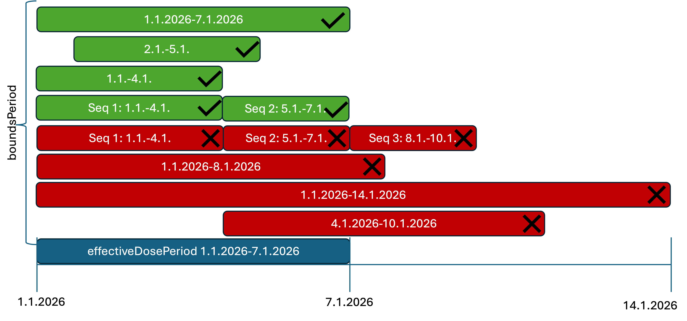
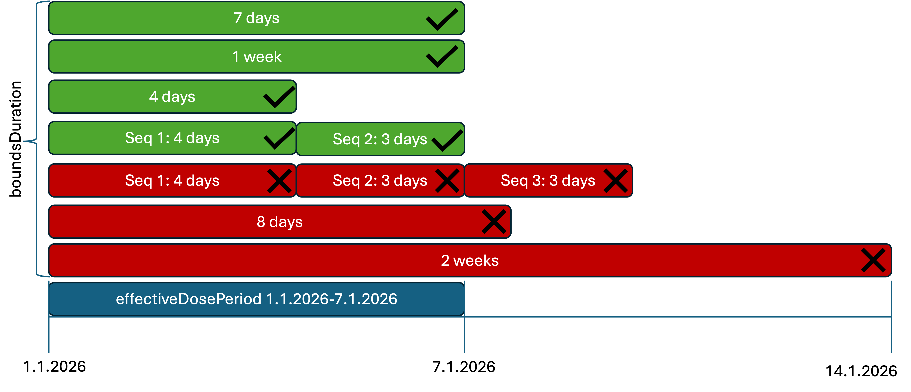
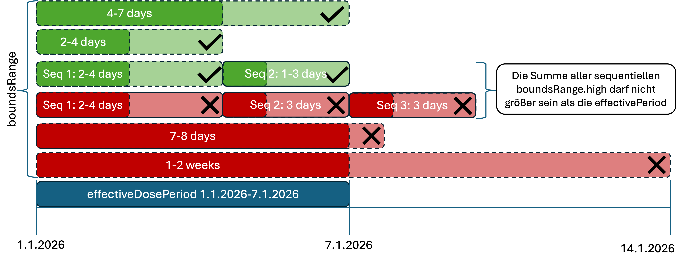
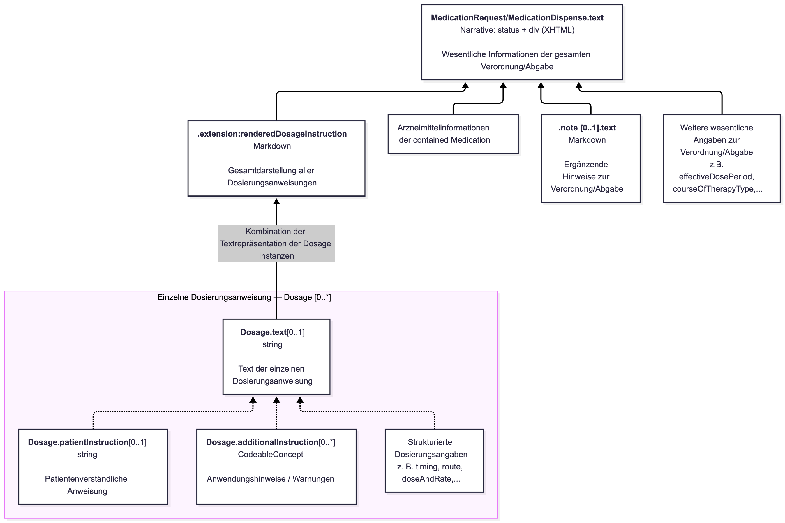

# Dosierungen - ELGA e-Medikation (R4) DRAFT v0.1.0

## Dosierungen

### Hinweis zum Reifegrad

 Die Dosierungsmodellierung wird derzeit noch fachlich und technisch finalisiert. Die in diesem Abschnitt beschriebenen Regeln, Dosierschemata und Profile stellen den aktuellen Arbeitsstand dar. Insbesondere sind bisher das Standard-Tageszeitenschema und die Freitextdosierung detaillierter ausgearbeitet. Sie dienen als Referenz für den generellen Modellierungsansatz; weitere Dosierschemata und Detailregeln folgen in einer kommenden Version des Implementation Guides. Feedback aus der Community ist ausdrücklich erwünscht. 

### Genereller Ansatz

Jede `Dosage` wird genau einer Dosierungskategorie zugeordnet. Die Kategorie wird über die Extension `Dosage.extension:DosageCategory` angegeben. Sie legt fest, nach welchem fachlichen Schema die Dosierung interpretiert wird und welches spezialisierte Dosage-Profil anzuwenden ist.

Die Kategorisierung ermöglicht, unterschiedliche Dosierschemata klar voneinander zu trennen. Dadurch kann jedes Schema gezielt eingeschränkt und validiert werden, ohne für alle Dosierungen die selben, oft zu allgemeinen Regeln verwenden zu müssen.

Vorteile dieses Ansatzes sind:

* Für jede Dosierungskategorie können konkrete Struktur- und Plausibilitätsregeln definiert werden.
* Es ist eindeutig festgelegt, welche Elemente innerhalb eines Schemas verwendet werden dürfen, müssen oder nicht verwendet werden dürfen.
* Eingabemasken der GDAs können gezielt auf die unterstützten Anwendungsfälle abgestimmt werden.
* Es kann festgelegt werden, welche Dosierungsanweisungen sequenziell/parallel kombiniert verwendet werden dürfen.
* Für jede Dosierungskategorie kann ein eigener Algorithmus zur Erzeugung einer menschenlesbaren Textdarstellung definiert werden.
* Empfänger können die strukturierte Dosierung anhand der Kategorie eindeutig interpretieren und müssen nicht aus einer Kombination optionaler Elemente auf das beabsichtigte Schema schließen.
* Schemaübergreifende Regeln, etwa für mehrere `dosageInstruction`-Einträge, können unabhängig von einzelnen Kategorien definiert werden.

#### Dosierschema Kategorien

Folgende Dosierungskategorien sind vorgesehen:

* **Standard-Tageszeitenschema:** Regelmäßig wiederkehrende Einnahmen zu standardisierten Tageszeiten, beispielsweise morgens, mittags, abends oder nachts (1-1-1-1). Dieses Schema wird durch das Profil [AT ELGA e-Medikation Dosage Standard Administration](StructureDefinition-at-elga-emed-dosage-standard-administration.md) beschrieben.
* **Freitextdosierung:** Dosierungsanweisungen, die nicht ausreichend oder nicht sinnvoll strukturiert abgebildet werden können. Dieses Schema wird durch das Profil [AT ELGA e-Medikation Dosage Freitext Administration](StructureDefinition-at-elga-emed-dosage-freetext-administration.md) beschrieben.
* **Uhrzeitenschema:** Einnahmen zu konkreten Uhrzeiten.
* **Intervallschema:** Einnahmen in regelmäßigen Zeitabständen, beispielsweise alle acht Stunden.
* **Einmalige Einnahme:** Einmalige Anwendung zu einem bestimmten Zeitpunkt oder in Bezug auf ein Ereignis.
* **Dosistitration:** Ein- oder Ausschleichen sowie andere Dosierungsänderungen mit mehreren aufeinanderfolgenden Behandlungsphasen.
* …

 Die finale Liste der Dosierungskategorien sowie die zugehörigen Profile werden noch erarbeitet und in einer zukünftigen Version des Implementation Guides ergänzt. Feedback aus der Community ist erwünscht. 

### Schemaübergreifende Regeln

Unabhängig von der verwendeten Dosierungskategorie gelten insbesondere für mehrere `dosageInstruction`-Einträge eines MedicationRequest oder MedicationDispense die folgenden Regeln:

* Alle Dosierungsanweisungen, die gemeinsam eine strukturierte Dosierung abbilden, MÜSSEN dieselbe Einheit für die Einzeldosis verwenden. Bei `doseAndRate.doseQuantity` betrifft dies insbesondere die Einheit.
* Dosierungsanweisungen mit demselben `sequence`-Wert gelten als parallel und beschreiben gemeinsam eine Behandlungsphase.
* Dosierungsanweisungen mit unterschiedlichen `sequence`-Werten beschreiben aufeinanderfolgende Behandlungsphasen. Die Reihenfolge ergibt sich aus dem aufsteigenden `sequence`-Wert.
* `sequence`-Werte MÜSSEN positiv sein und ohne Lücken vergeben werden.
* Werden zeitliche Grenzen über `timing.repeat.bounds[x]` angegeben, MÜSSEN diese innerhalb einer Sequenz konsistent verwendet werden. Insbesondere dürfen parallele Dosierungsanweisungen nicht in `timing.repeat.bounds[x]` voneinander abweichen.
* Wird in einer der Dosierungen `boundsPeriod` verwendet, so müssen alle Dosierungen `timing.repeat.boundsPeriod` verwenden
* Alle Dosierungsanweisungen MÜSSEN immer denselben Wiederholungszeitraum verwenden. `timing.repeat.period` und `timing.repeat.periodUnit` dürfen innerhalb einer Sequenz nicht voneinander abweichen (immer täglich oder immer wöchentlich bzw. monatlich)
* Für unterschiedliche Sequenzen dürfen unterschiedliche zeitliche Begrenzungen verwendet werden, sofern diese eine widerspruchsfreie zeitliche Abfolge der Behandlungsphasen ergeben und `effectiveDosePeriod` nicht widersprechen.
* `timing.repeat.bounds[x]` und `effectiveDosePeriod` MÜSSEN widerspruchsfrei sein. Ein durch `boundsPeriod` angegebener Zeitraum darf nicht außerhalb von `effectiveDosePeriod` liegen.
* Eine strukturierte Dosierung MUSS ausreichend vollständig sein, um die Einnahme oder Anwendung ohne Rückgriff auf einen Freitext zu bestimmen. Ist dies nicht möglich, ist eine Freitextdosierung zu verwenden.

 Die finale Liste der schemaübergreifenden Regeln wird noch erarbeitet und im nächsten Ballot zur Verfügung gestellt. Feedback aus der Community ist erwünscht. 

### Verwendung mehrerer Sequences

Ein Dosierschema kann aus mehreren `dosageInstruction`-Einträgen bestehen. Das Element `sequence` legt fest, ob diese Einträge parallel gelten oder nacheinander anzuwenden sind. Dabei ist zwischen einer einzelnen Dosierungsanweisung und einer Sequenz zu unterscheiden: Mehrere Dosierungsanweisungen können gemeinsam eine Sequenz bilden.

* Parallele Dosierungsanweisungen haben denselben `sequence`-Wert. Sie beschreiben gemeinsam das Dosierschema einer Behandlungsphase, beispielsweise unterschiedliche Einnahmemengen am Morgen und in der Nacht.
* Sequentielle Dosierungsanweisungen haben unterschiedliche `sequence`-Werte. Sie werden in aufsteigender Reihenfolge angewendet, beispielsweise zuerst eine höhere und anschließend eine niedrigere Dosierung. Innerhalb jeder dieser Sequenzen können wiederum mehrere parallele Dosierungsanweisungen vorkommen.

„Parallel“ bedeutet dabei **nicht**, dass die Einnahmen zum selben Zeitpunkt stattfinden. Die konkreten Einnahmezeitpunkte ergeben sich aus `timing`. Unterschiedliche Tageszeiten oder Wochentage erfordern daher keine unterschiedlichen `sequence`-Werte, solange die Anweisungen zur selben Behandlungsphase gehören und die selbe Einnahmemenge besitzen.

Die folgenden Beispiele zeigen die Aufteilung eines Standard-Tageszeitenschemas auf mehrere Dosierungsanweisungen. Die Angaben dienen ausschließlich der Veranschaulichung der Modellierung.

#### Täglich mit unterschiedlicher Tablettenanzahl pro Tageszeit

Es werden täglich zwei Stück morgens, zwei Stück abends und ein Stück nachts eingenommen. Die Einnahmen am Morgen und am Abend können in einer Dosierungsanweisung zusammengefasst werden, da für beide dieselbe Einzeldosis gilt. Für die abweichende Einzeldosis in der Nacht wird eine zweite Dosierungsanweisung benötigt. Beide Einträge erhalten `sequence = 1`, da sie gemeinsam das tägliche Dosierschema beschreiben.

| | | | | | |
| :--- | :--- | :--- | :--- | :--- | :--- |
| A | 1 | `MORN`,`EVE` | 2 | `1 d` | 2 Stück |
| B | 1 | `NIGHT` | 1 | `1 d` | 1 Stück |

Die Einzeldosis gilt jeweils pro Einnahmezeitpunkt. Die beiden Stück aus Dosierungsanweisung A werden somit sowohl morgens als auch abends eingenommen.

```
                        Sequenz 1
              ┌─────────────────────────────────┐
              │ morgens  mittags  abends  nachts│
Anweisung A   │    2         –       2       –  │
Anweisung B   │    –         –       –       1  │
              ├─────────────────────────────────┤
Gesamtschema  │    2         0       2       1  │
              └─────────────────────────────────┘
                         täglich

```

#### Wöchentlich mit unterschiedlichen Tageszeiten pro Wochentag

In diesem Beispiel erfolgt die Einnahme montags, mittwochs und freitags morgens sowie dienstags und donnerstags abends. Die Einzeldosis beträgt jeweils ein Stück. Da die Zuordnung von Wochentagen zu Tageszeiten unterschiedlich ist, werden zwei Dosierungsanweisungen verwendet. `dayOfWeek` legt die Wochentage fest, `when` die jeweilige Tageszeit. Beide Anweisungen gehören zur gleichen Sequenz.

| | | | | | | |
| :--- | :--- | :--- | :--- | :--- | :--- | :--- |
| A | 1 | `mon`,`wed`,`fri` | `MORN` | 3 | `1 wk` | 1 Stück |
| B | 1 | `tue`,`thu` | `EVE` | 2 | `1 wk` | 1 Stück |

```
                         Sequenz 1
              Mo    Di    Mi    Do    Fr    Sa    So
morgens        1     –     1     –     1     –     –
mittags        –     –     –     –     –     –     –
abends         –     1     –     1     –     –     –
nachts         –     –     –     –     –     –     –

                    wöchentlich wiederholt

```

Die `frequency` bezieht sich in dieser Darstellung auf die jeweilige Dosierungsanweisung und den angegebenen Zeitraum: Anweisung A beschreibt drei, Anweisung B zwei Einnahmen pro Woche.

#### Wöchentlich mit unterschiedlichen Tageszeiten und Tablettenanzahlen

Das vorherige Beispiel wird um unterschiedliche Einzeldosen erweitert: Montags, mittwochs und freitags werden jeweils zwei Stück morgens und ein Stück nachts eingenommen. Dienstags und donnerstags wird jeweils ein Stück abends eingenommen.

Hierfür werden drei Dosierungsanweisungen verwendet. Die morgendliche und nächtliche Einnahme an denselben Wochentagen werden getrennt abgebildet, da sich ihre Einzeldosen unterscheiden. Alle drei Anweisungen erhalten weiterhin `sequence = 1`.

| | | | | | | |
| :--- | :--- | :--- | :--- | :--- | :--- | :--- |
| A | 1 | `mon`,`wed`,`fri` | `MORN` | 3 | `1 wk` | 2 Stück |
| B | 1 | `mon`,`wed`,`fri` | `NIGHT` | 3 | `1 wk` | 1 Stück |
| C | 1 | `tue`,`thu` | `EVE` | 2 | `1 wk` | 1 Stück |

```
                         Sequenz 1
              Mo    Di    Mi    Do    Fr    Sa    So
morgens        2     –     2     –     2     –     –
mittags        –     –     –     –     –     –     –
abends         –     1     –     1     –     –     –
nachts         1     –     1     –     1     –     –

                    wöchentlich wiederholt

```

#### Aufeinanderfolgende Sequenzen

Ändert sich das Dosierschema im Verlauf der Behandlung, werden die Behandlungsphasen durch unterschiedliche `sequence`-Werte unterschieden. Beispielsweise kann auf das tägliche Schema `2-0-2-1` aus dem Ausgangsbeispiel eine zweite Phase mit dem Schema `1-0-1-0` folgen. Die beiden Dosierungsanweisungen der ersten Phase erhalten `sequence = 1`; die Dosierungsanweisung der anschließenden Phase erhält `sequence = 2`.

```
Zeit ─────────────────────────────────────────────────────►

       Sequenz 1                       Sequenz 2
       täglich 2-0-2-1                 täglich 1-0-1-0

       ┌────────────────────────┐      ┌─────────────────────┐
       │ A: 2 Stück             │      │ C: 1 Stück          │
       │    morgens und abends  │ ───► │    morgens und      │
       │ B: 1 Stück nachts      │      │    abends           │
       └────────────────────────┘      └─────────────────────┘
          A und B gelten                  C gilt
          parallel                        anschließend

```

Der `sequence`-Wert beschreibt die Reihenfolge, nicht die Dauer oder den konkreten Wechselzeitpunkt. Die zeitliche Begrenzung der einzelnen Phasen wird über `timing.repeat.bounds[x]` angegeben und mit dem übergeordneten Einnahmezeitraum abgestimmt; siehe Abschnitt [Datumsangaben](#datumsangaben).

### Datumsangaben

Die zeitliche Gültigkeit einer Medikation wird auf zwei Ebenen beschrieben: `effectiveDosePeriod` gibt den übergeordneten Einnahmezeitraum an, während `Dosage.timing.repeat.bounds[x]` die zeitliche Begrenzung einer einzelnen Dosierungsanweisung innerhalb dieses Zeitraums beschreibt. Diese Unterscheidung ist insbesondere bei Dosierschemata mit mehreren aufeinanderfolgenden Sequenzen relevant, beispielsweise beim Ein- oder Ausschleichen eines Medikaments.

Für die zeitliche Begrenzung einer Dosierungsanweisung stehen folgende Varianten zur Verfügung:

* `boundsPeriod`: Angabe eines konkreten Zeitraums mit Beginn und/oder Ende.
* `boundsDuration`: Angabe einer Dauer, beispielsweise „1 Woche“.
* `boundsRange`: Angabe eines Bereichs für die Dauer, beispielsweise „2 bis 3 Wochen“.

`effectiveDosePeriod` und die zeitlichen Begrenzungen der einzelnen Dosierungsanweisungen MÜSSEN aufeinander abgestimmt sein und dürfen sich nicht widersprechen. Ist der Einnahmezeitraum durch Beginn und Ende begrenzt, MUSS jede Dosierungsanweisung vollständig innerhalb dieses Zeitraums ausführbar sein. Ein mit boundsPeriod angegebener Zeitraum darf daher nicht über den Einnahmezeitraum hinausreichen. Bei boundsDuration und boundsRange muss die angegebene Dauer beziehungsweise der gesamte angegebene Bereich innerhalb des Einnahmezeitraums liegen.

 Die Auswirkungen von Timing.repeat.offset wurden in dieser Version noch nicht betrachtet. 

#### Beispiele:

| | | | | |
| :--- | :--- | :--- | :--- | :--- |
| 1.10.2026 bis 1.11.2026 | boundsPeriod | 1.10.2026 bis 1.11.2026 | Ja | Medikament soll für den gesamten Einnahmezeitraum eingenommen werden |
| 1.10.2026 bis 1.11.2026 | boundsPeriod | 1.10.2026 bis 1.12.2026 | Nein | Einnahmezeitraum müsste angepasst werden. |
| 1.10.2026 bis 1.11.2026 | boundsRange | 2-3 Wochen | Ja | Einnahme für 2-3 Wochen innerhalb des angegebenen Einnahmezeitraums. |
| 1.10.2026 bis 5.10.2026 | boundsRange | 1 Wochen | Nein | Einnahmezeitraum müsste angepasst werden. |
| 1.10.2026 bis 1.11.2026 | boundsDuration | 1 Woche | Ja | Einnahme für 1 Wochen innerhalb des angegebenen Einnahmezeitraums. |

#### Kombinationen aus effectivedosePeriod und boundsPeriod



#### Kombinationen aus effectivedosePeriod und boundsDuration



#### Kombinationen aus effectivedosePeriod und boundsRange



### Textdarstellungen und ergänzende Hinweise

 Der finale Algorithmus für die Generierung der menschenlesbaren Textdarstellungen der einzelnen Ressourcen und Dosierschemata wird noch erarbeitet und im nächsten Ballot zur Verfügung gestellt. Feedback aus der Community ist erwünscht. </ul> 

Die strukturierte Dosierung ist die primäre, maschinenlesbare Repräsentation. **Die Textdarstellung unterstützt die menschliche Lesbarkeit, darf jedoch nicht als Ersatz für strukturierte Daten verwendet werden, wenn die Dosierung durch ein unterstütztes Dosierschema vollständig abbildbar ist.**

Für strukturierte Dosierungen soll `Dosage.text` aus den strukturierten Elementen der jeweiligen `Dosage` vom Server generiert und befüllt werden. Bei mehreren `dosageInstruction`-Einträgen fasst `renderedDosageInstruction` die Dosierung des gesamten MedicationRequest beziehungsweise MedicationDispense zusammen. Der genaue Algorithmus für die Zusammenführung mehrerer paralleler und sequenzieller Dosierungsanweisungen wird noch festgelegt.

Kann eine Dosierung nicht mit einem unterstützten Schema vollständig und widerspruchsfrei strukturiert dargestellt werden, ist die Dosierungskategorie `freitext` zu verwenden. In diesem Fall enthält `Dosage.text` die maßgebliche Dosierungsanweisung.

Die folgenden Elemente unterstützen die menschenlesbare Darstellung von Ressourcen, welche eine Dosierung enthalten. Sie unterscheiden sich in ihrem Geltungsbereich: Die Narrative beschreibt den MedicationRequest/MedicationDispense als Ganzes, die Dosierungstexte beschreiben die Einnahme bzw. Anwendung und ergänzende Hinweise enthalten weitere Informationen. Nicht alle Texte werden aus strukturierten Daten generiert. Insbesondere können Freitextanweisungen Informationen enthalten, die nicht zusätzlich strukturiert vorliegen.



| | | |
| :--- | :--- | :--- |
| `MedicationRequest.text` | `Narrative`→ XHTML in`div` | Menschenlesbare Textrepräsentation der wesentlichen Informationen der gesamten Ressource. Enthält die für das Verständnis relevanten Informationen einschließlich der Dosierung und der (`contained`)`Medication`. |
| `MedicationRequest.note.text` | `markdown`innerhalb von`Annotation` | Zusätzliche Informationen zum Planeintrag, z. B. „Kontrolle der Blutwerte innerhalb von vier Wochen erforderlich“. |
| `MedicationRequest.extension:renderedDosageInstruction` | `markdown`(`valueMarkdown`) | Da ein MedicationRequest/MedicationDispense mehrere Dosages besitzten kann bildet renderedDosageInstruction eine gesamte Textrepräsentation aller Medicationrequest.dosageInstructions ab. Gibt es nur eine dosageInstruction so entspricht der inhalt von extension:renderedDosageInstruction dem Inhalt von dosageInstruction.text. |
| `MedicationRequest.dosageInstruction.text` | `string` | Textrepräsentation einer einzelnen`Dosage`-Instanz. Berücksichtigt auch die Inhalte von`additionalInstruction`und`patientInstruction`. Bei einer Dosierung die nicht strukturiert abgebildet werden kann stellt dieses Element das Freitextfeld für die Repräsentation der Dosierung dar. |
| `MedicationRequest.dosageInstruction.additionalInstruction` | `CodeableConcept` | Ergänzende Einnahme- oder Anwendungshinweise und Warnhinweise, die codiert angegeben werden können. |
| `MedicationRequest.dosageInstruction.patientInstruction` | `string` | Zusätzlicher Einnahme/Anwendungs-hinweis für den Patienten. |

 `Dosage.additionalInstruction` KANN für ergänzende, standardisiert codierbare Einnahme-, Anwendungs- oder Warnhinweise verwendet werden. Das Element ergänzt die eigentliche Dosierungsanweisung, ersetzt jedoch weder `Dosage.timing`, `doseAndRate` noch `Dosage.patientInstruction`. 

 Geeignete Inhalte sind insbesondere Hinweise, die sich als begrenzte Auswahl vordefinierter Werte erfassen lassen und deren Bedeutung für die sichere Anwendung relevant ist. Beispiele können Hinweise zur Einnahme in Bezug auf Mahlzeiten, zur besonderen Art der Anwendung oder zur Aufbewahrung sein. 

 `additionalInstruction` SOLL nicht für individuelle, lange oder komplexe Freitextanweisungen verwendet werden. Solche Informationen sind in `patientInstruction` abzubilden. Hinweise, die bereits vollständig durch `timing`, `route`, `method`, `site` oder andere strukturierte Elemente ausgedrückt werden, SOLLEN nicht redundant in `additionalInstruction` wiederholt werden. 

 Gibt es eine sinnvolle Verwendung für das Feld `Dosage.additionalInstruction`? Welche Ausprägungen/Codierten Werte würden hier Sinn machen? Community Feedback ist erwünscht. 

