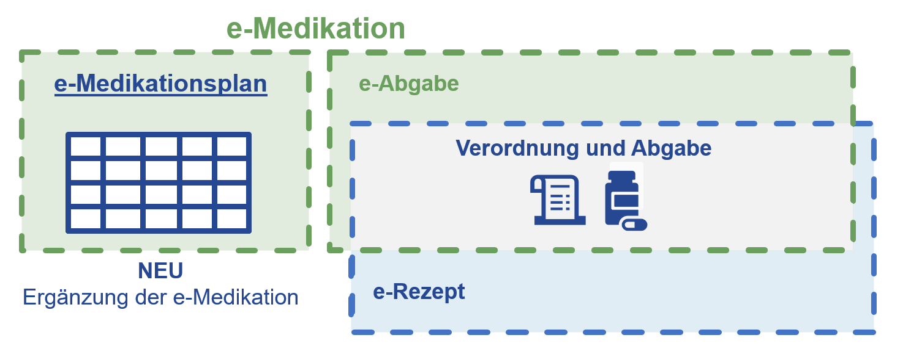

# Home - ELGA e-Medikation (R4) DRAFT v0.1.0

## Home

### e-Medikation (v4)

Der vorliegende **FHIR Implementation Guide e‑Medikation Version 4** ersetzt die bestehende, auf CDA basierende Version 2 der e‑Medikation.

* Mit Version 4 wird die bestehende Umsetzung der e‑Medikation um die Funktionalität des e‑Medikationsplans ergänzt.
* Darüber hinaus sollen alle **Geplanten** und **Durchgeführten Abgaben** von Medikamenten in der e-Abgabe als Teil von e-Medikation abgebildet werden.

Der **e‑Medikationsplan** bietet Behandler:innen und Patient:innen eine vollständige, strukturierte Übersicht über die aktuelle sowie die historische Medikation. Zentrales Element ist die Verordnung, welche im jeweiligen e‑Medikationsplaneintrag mit sämtlichen relevanten Einnahmedetails digital abgebildet wird. Diese Verordnung bildet die Grundlage für die Folgeprozesse Weiterverordnung, Rezeptierung und Abgabe. Die Einsicht in **Geplante** und **Durchgeführte Abgaben** (mit und ohne Medikationsplanbezug) in **e-Abgabe** soll die Vollständigkeit der Information zur Medikation gewährleisten.

Die Einführung des E-Medikationsplans gewährleistet, dass alle für die Therapieentscheidung relevanten Informationen verfügbar sind, Doppelverordnungen vermieden werden und die Patient:innensicherheit erhöht wird. Darüber hinaus fungiert der e‑Medikationsplan als Datengrundlage für die automatisierte Übernahme relevanter Medikationsinformationen in die **ELGA Patient Summary**.

Die technische Umsetzung des E-Medikationsplans sowie der e-Abgabe erfolgt auf Basis des HL7® FHIR®-Standards, um eine nachhaltige, interoperable und kosteneffiziente Lösung zu gewährleisten. Die vorliegende Implementierung leistet einen Beitrag zur Weiterentwicklung sowohl der österreichischen eHealth-Strategie als auch der Anforderungen des European Health Data Space (EHDS).

Der Implementation Guide umfasst zudem die Definition der FHIR-APIs für die Integration der e-Medikation in die ELGA-Infrastruktur.

