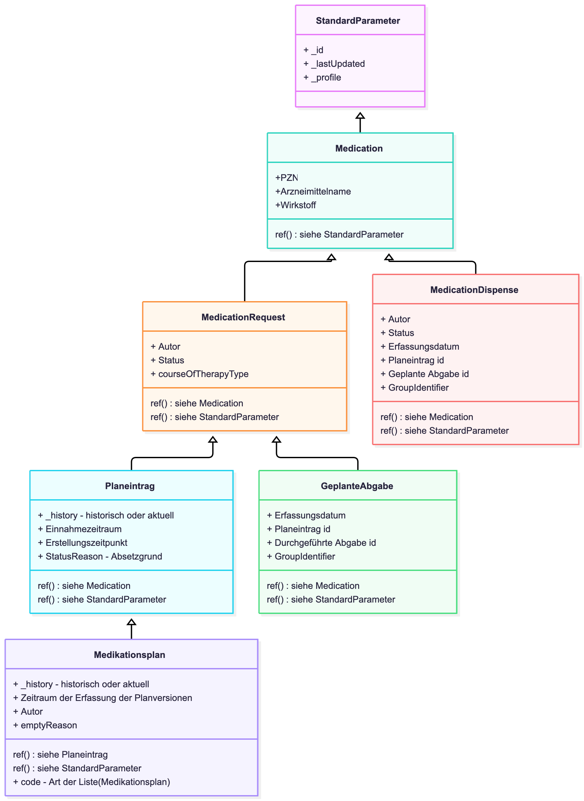

# Transaktionen - ELGA e-Medikation (R4) DRAFT v0.1.0

## Transaktionen

Die Umsetzung des Patientenkontakts in den Transaktionen ist nicht Teil des Ballots. Der konkrete Zugriff wird in der [Lösungsarchitektur](https://dev.elga.gv.at/apis/emed/latest/emed-fhir-anbindung/) beschrieben.

In diesem IG werden daher alle Requests ab dem `/[type]` dargestellt.

| | | | | | | |
| :--- | :--- | :--- | :--- | :--- | :--- | :--- |
| **POST** | `/` | `$groupidentifier-create` |  | Erzeugen eines neuen e-Med GroupIdentifiers für Geplante Abgaben | GDA |  |
| **POST** | `/` | `$groupidentifier-search` |  | Geplante und Durchgeführte Abgaben mittels e-Med GroupIdentifier lesen | GDA |  |
| **POST** | `/List` | `$plan-read` | Medikationsplan | Aktuelle Medikationsplanversion lesen | GDA, PAT |  |
| **POST** | `/List` | `$plan-write` | Medikationsplan | Neue Version eines Medikationsplans schreiben | GDA |  |
| **POST** | `/List` | `$history-delete` | Medikationsplan | Aktuelle oder historische Medikationsplanversion löschen | PAT |  |
| **POST** | `/List` | `$history-search` | Medikationsplan | plan-history-search & plan-history-directory-search:In historischen Medikationsplanversion(en) suchen und alle referenzierten Ressourcen inkludieren. Directory-Search wenn der Parameter`include`nicht verwendet wird. | GDA, PAT | [List (Search-) parameters](StructureDefinition-at-elga-emed-list-medikationsplan.md#search-parameters) |
| **POST** | `/MedicationRequest` | `$prescription-write` | [Geplante Abgabe](StructureDefinition-at-elga-emed-medicationrequest-geplanteabgabe.md) | Geplante Abgabe schreiben | GDA |  |
| **POST** | `/MedicationRequest` | `$history-search` | [Planeintrag](StructureDefinition-at-elga-emed-medicationrequest-planeintrag.md) | In historischen Planeintragsversionen suchen und alle referenzierten Ressourcen inkludieren. Nur MedicationRequests ohne referenzierte Ressourcen, wenn`include`nicht verwendet wird.Gilt ausschließlich für Planeinträge, nicht für Geplante Abgaben. | GDA, PAT | [Planeintrag (Search-) parameters](StructureDefinition-at-elga-emed-medicationrequest-planeintrag.md#search-parameters) |
| **GET** | `/MedicationRequest?category=Planeintrag` | `search-type` | [Planeintrag](StructureDefinition-at-elga-emed-medicationrequest-planeintrag.md) | planentry-search: Aktuelle Planeinträge suchen (`?category=Planeintrag`) | GDA, PAT | [Planeintrag (Search-) parameters](StructureDefinition-at-elga-emed-medicationrequest-planeintrag.md#search-parameters) |
| **GET** | `/MedicationRequest?category=GeplAbgabe` | `search-type` | [Geplante Abgabe](StructureDefinition-at-elga-emed-medicationrequest-geplanteabgabe.md) | prescription-search: Geplante Abgaben suchen (`?category=GeplAbgabe`) | GDA, PAT | [Geplante Abgabe (Search-) parameters](StructureDefinition-at-elga-emed-medicationrequest-geplanteabgabe.md#search-parameters) |
| **POST** | `/MedicationRequest/[id]` | `$prescription-discard` | [Geplante Abgabe](StructureDefinition-at-elga-emed-medicationrequest-geplanteabgabe.md) | Eigene Geplante Abgabe stornieren | GDA |  |
| **POST** | `/MedicationRequest/[id]` | `$planentry-delete` | [Planeintrag](StructureDefinition-at-elga-emed-medicationrequest-planeintrag.md) | Gesamte Historie eines Planeintrags löschen | PAT |  |
| **DELETE** | `/MedicationRequest/[id]` | `delete` | [Geplante Abgabe](StructureDefinition-at-elga-emed-medicationrequest-geplanteabgabe.md) | prescription-delete: Geplante Abgabe löschen; nur für Geplante Abgaben | PAT |  |
| **POST** | `/MedicationDispense` | `$dispense-write` | [Durchgeführte Abgabe](StructureDefinition-at-elga-emed-medicationdispense-durchgefuehrteabgabe.md) | Durchgeführte Abgabe schreiben | GDA |  |
| **GET** | `/MedicationDispense` | `search-type` | [Durchgeführte Abgabe](StructureDefinition-at-elga-emed-medicationdispense-durchgefuehrteabgabe.md) | dispense-search: Durchgeführte Abgaben suchen | GDA, PAT | [MedicationDispense (Search-) parameters](StructureDefinition-at-elga-emed-medicationdispense-durchgefuehrteabgabe.md#search-parameters) |
| **POST** | `/MedicationDispense/[id]` | `$dispense-discard` | [Durchgeführte Abgabe](StructureDefinition-at-elga-emed-medicationdispense-durchgefuehrteabgabe.md) | Eigene durchgeführte Abgabe stornieren | GDA |  |
| **POST** | `/MedicationDispense/[id]` | `$reference-plan` | [Durchgeführte Abgabe](StructureDefinition-at-elga-emed-medicationdispense-durchgefuehrteabgabe.md) | Referenz auf Medikationsplan erstellen | GDA |  |
| **DELETE** | `/MedicationDispense/[id]` | `delete` | [Durchgeführte Abgabe](StructureDefinition-at-elga-emed-medicationdispense-durchgefuehrteabgabe.md) | dispense-delete: Durchgeführte Abgabe löschen | PAT |  |

### Suchparameter Überblick

